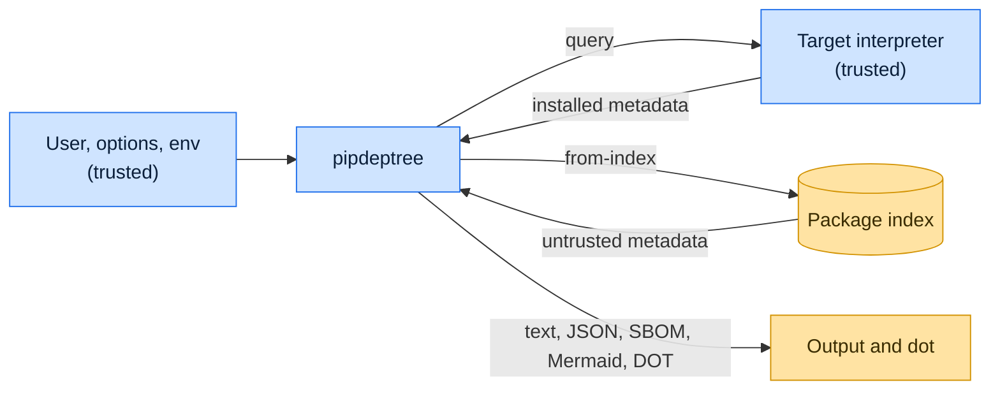

# Threat model

This model says what pipdeptree trusts, where untrusted input enters, and which guarantees hold at each boundary, so a
report can be classified as a vulnerability or a bug. [SECURITY.md](SECURITY.md) covers reporting; if the two disagree,
SECURITY.md wins and we fix this file.

## How pipdeptree works

pipdeptree reads the distribution metadata of an environment, either in the running interpreter or by querying the one
named with `--python`, and builds a graph of requirements, versions and conflicts. The `from-index` subcommand instead
resolves requirements against package indexes with Nab and renders the resolution. Output goes to the terminal as text
or in machine formats (JSON, CycloneDX SBOM, Mermaid, DOT); `graphviz-FMT` pipes DOT text to the `dot` binary.

## Compared with similar tools

We drew the boundary where comparable projects in other ecosystems draw theirs. The shared rule, stated by the
[Node.js threat model](https://github.com/nodejs/node/blob/main/SECURITY.md#the-nodejs-threat-model), is that a report
which first needs a trusted element compromised is out of scope; the first triage question, as
[DOMPurify](https://github.com/cure53/DOMPurify/blob/main/SECURITY.md#what-we-consider-a-vulnerability) puts it, is what
the attacker controls.

| Project                                                             | Language   | Where it draws the line                                                                       |
| ------------------------------------------------------------------- | ---------- | --------------------------------------------------------------------------------------------- |
| [npm CLI (`npm ls`)](https://github.com/npm/cli/security/policy)    | JavaScript | Reports through a private channel; the installed tree it lists is the user's own and trusted. |
| [pnpm](https://github.com/pnpm/pnpm/security/policy)                | JavaScript | Treats registry metadata as untrusted and the local store and project as trusted.             |
| [Cargo (`cargo tree`)](https://www.rust-lang.org/policies/security) | Rust       | The Rust security policy covers Cargo; registry index data is the untrusted input.            |

## Trusted

An attacker who controls any of these already has what pipdeptree could give them:

- The user and every option and environment variable, index URLs and credentials included.
- The inspected environment: its interpreter and installed distributions.
- The Graphviz `dot` binary found on `PATH`.

## Untrusted inputs

| Input                               | Comes from                                      | What pipdeptree guarantees                                                                          |
| ----------------------------------- | ----------------------------------------------- | --------------------------------------------------------------------------------------------------- |
| Package metadata from `from-index`  | Any package published to the configured indexes | Requirements are parsed as PEP 508; names and versions are emitted as data, quoted in DOT and JSON. |
| Metadata of installed distributions | Whoever published a package the user installed  | Rendered as data in every output format.                                                            |

## Threats and controls

| STRIDE            | Threat                                                           | Control                                                       |
| ----------------- | ---------------------------------------------------------------- | ------------------------------------------------------------- |
| Tampering         | A crafted version string closes a DOT label and adds fake edges. | DOT identifiers are quoted and escaped; labels escape quotes. |
| Denial of service | A dependency cycle or huge index response stalls rendering.      | Cycles are detected and reported; no other bound is promised. |

## Release chain

Releases run on the shared [tox-dev/github-workflows](https://github.com/tox-dev/github-workflows) pipeline. A release
App, not a person, pushes the release commit and tag; the build installs its tools hash-checked from `pylock.toml` with
a seven-day upload cooldown; PyPI receives the files through
[trusted publishing](https://docs.pypi.org/trusted-publishers/) with attestations, and the GitHub Release is immutable.
Every workflow pins third-party actions to a commit SHA.

## Vulnerability or bug

| Report                                                                                  | Verdict             | Why                                              |
| --------------------------------------------------------------------------------------- | ------------------- | ------------------------------------------------ |
| A package on PyPI with `"` in its metadata injects a node into `-o graphviz-svg` output | Vulnerability       | Untrusted metadata escapes its field.            |
| `pipdeptree --python ./evil` runs `./evil`                                              | Not a vulnerability | The interpreter is the user's choice.            |
| The tree shows a misleading but valid package name                                      | Not a vulnerability | pipdeptree reports metadata; it does not vet it. |

## Accepted risks

- pipdeptree runs the chosen interpreter to inspect it.
- `from-index` trusts the configured indexes' TLS and hosts; it does not verify signatures.

## Keeping this current

Revisit this model when pipdeptree gains a new input source, network access, a new way to run code, or a new place it
writes to, and whenever an advisory is published.
