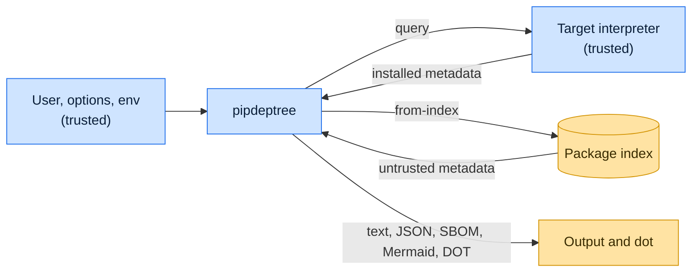

# Threat model

This model says what pipdeptree trusts, where untrusted input enters, and which guarantees hold at each boundary, so a
report can be classified as a vulnerability or a bug. [SECURITY.md](SECURITY.md) covers reporting; if the two disagree,
SECURITY.md wins and we fix this file.

## How pipdeptree works

pipdeptree's parsing, graph building and rendering run in a Rust extension; a thin Python layer connects it to the
streams and the desktop opener. It reads the distribution metadata of an environment, either the running interpreter's
or one it queries with `--python`, and builds a graph of requirements, versions and conflicts. `from-index` resolves
requirements, requirement files or `pyproject.toml` files against package indexes with Nab, and `from-lock` renders a
PEP 751 lock without network access. Output is text or a machine format (JSON, CycloneDX SBOM, Mermaid, DOT);
`graphviz-FMT` pipes DOT text to the `dot` binary, and binary output on a terminal goes to a temporary file opened with
the default application.

## Compared with similar tools

We drew the boundary where comparable projects in other ecosystems draw theirs. The shared rule, stated by the
[Node.js threat model](https://github.com/nodejs/node/blob/main/SECURITY.md#the-nodejs-threat-model), is that a report
which first needs a trusted element compromised is out of scope; the first triage question, as
[DOMPurify](https://github.com/cure53/DOMPurify/blob/main/SECURITY.md#what-we-consider-a-vulnerability) puts it, is what
the attacker controls.

| Project                                                             | Language   | Where it draws the line                                                                                                                                                  |
| ------------------------------------------------------------------- | ---------- | ------------------------------------------------------------------------------------------------------------------------------------------------------------------------ |
| [npm CLI (`npm ls`)](https://github.com/npm/cli/security/policy)    | JavaScript | Follows GitHub's open source reporting policy, which defines no scope of its own.                                                                                        |
| [pnpm](https://github.com/pnpm/pnpm/security/policy)                | JavaScript | Draws its boundary at filesystem permissions: the store, project, lockfile and configuration are trusted, and running it in a repository means trusting that repository. |
| [Cargo (`cargo tree`)](https://www.rust-lang.org/policies/security) | Rust       | The Rust toolchain, Cargo included, assumes the user's code and dependencies are trusted; compiling or analyzing a malicious project is out of scope.                    |

pnpm and Cargo act on the project in the working directory, so they trust it. pipdeptree inspects an environment, not
the project it runs in, so the working directory is not trusted: running pipdeptree inside a cloned repository must not
run or report anything from that repository unless an option points at it.

## Trusted

An attacker who controls any of these already has what pipdeptree could give them:

- The user and every option and environment variable, index URLs and credentials included.
- The inspected environment: its interpreter and installed distributions.
- The Graphviz `dot` binary found on `PATH`.

## Untrusted inputs

| Input                                              | Comes from                                                                            | What pipdeptree guarantees                                                                         |
| -------------------------------------------------- | ------------------------------------------------------------------------------------- | -------------------------------------------------------------------------------------------------- |
| Package metadata from `from-index` and `from-lock` | Any package published to the configured indexes, or a lock file from a pull request   | Requirements are parsed as PEP 508; names and versions are emitted as data in every output format. |
| Metadata of installed distributions                | Whoever published a package the user installed                                        | Read from files, never imported; rendered as data in every output format.                          |
| The working directory                              | Whoever wrote the repository, checkout or archive pipdeptree runs in                  | Nothing in it is imported, run or reported as installed unless an option names it.                 |
| Files other local users can write                  | Another account on the same machine, for example through a shared temporary directory | Never read as configuration or built; temporary files are created where only the user can write.   |

## Threats and controls

| STRIDE                 | Threat                                                                      | Control                                                                                                              |
| ---------------------- | --------------------------------------------------------------------------- | -------------------------------------------------------------------------------------------------------------------- |
| Tampering              | A crafted version string closes a DOT or Mermaid label and adds fake edges. | DOT identifiers are quoted with backslashes and quotes escaped; labels escape quotes. Report any label that escapes. |
| Tampering              | A control character in metadata sends escape sequences to the terminal.     | Control characters in names, versions, header values, `direct_url.json` fields and lock strings become U+FFFD.       |
| Denial of service      | A dependency cycle or huge response stalls rendering.                       | Cycles are detected and reported; `dot` is stopped after 300 seconds; report anything unbounded.                     |
| Elevation of privilege | Inspecting metadata runs package code.                                      | Metadata files are parsed in Rust; the environment's interpreter runs only to report its paths.                      |

## Release chain

Releases run on the shared [tox-dev/github-workflows](https://github.com/tox-dev/github-workflows) pipeline. A release
App, not a person, pushes the release commit and tag; the build installs its tools from a hash-checked `pylock.toml`
resolved with a seven-day upload cooldown by default; PyPI receives the files through
[trusted publishing](https://docs.pypi.org/trusted-publishers/) with attestations, and the GitHub Release is immutable.
Every workflow pins third-party actions to a commit SHA.

## Vulnerability or bug

| Report                                                                                  | Verdict             | Why                                              |
| --------------------------------------------------------------------------------------- | ------------------- | ------------------------------------------------ |
| A package on PyPI with `"` in its metadata injects a node into `-o graphviz-svg` output | Vulnerability       | Untrusted metadata escapes its field.            |
| `pipdeptree --python ./evil` runs `./evil`                                              | Not a vulnerability | The interpreter is the user's choice.            |
| The tree shows a misleading but valid package name                                      | Not a vulnerability | pipdeptree reports metadata; it does not vet it. |

## Severity

- **High:** inspecting metadata executes code, or a fixed `dot` invocation runs something else.
- **Medium:** metadata escapes its field and forges packages or edges in JSON, CycloneDX, DOT or Mermaid output, or
  index credentials reach the output.
- **Low:** a crash, panic or hang on malformed input, or a rendering defect that forges nothing.

## Accepted risks

- pipdeptree runs the chosen interpreter to inspect it.
- `from-index` trusts the configured indexes' TLS and hosts; it does not verify signatures.

## Keeping this current

Revisit this model when pipdeptree gains a new input source, network access, a new way to run code, or a new place it
writes to, and whenever an advisory is published.
